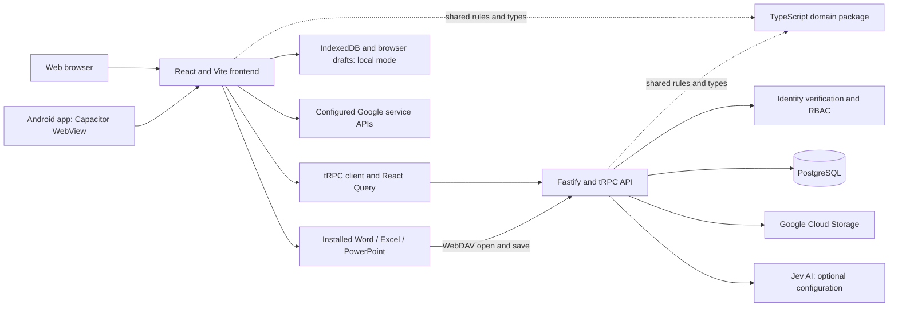
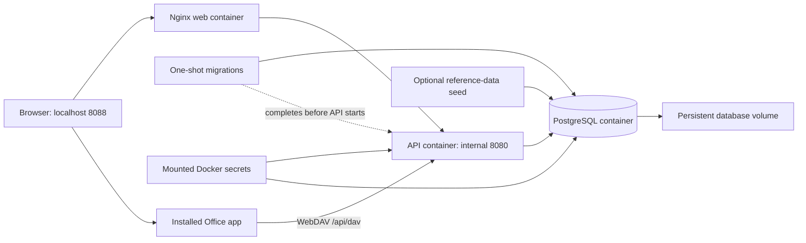
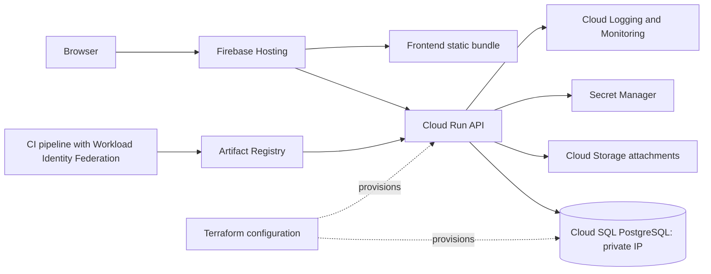
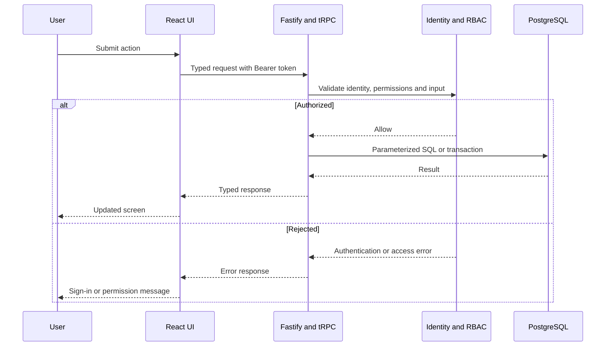

# Architecture and line diagrams

These Mermaid diagrams describe the current architecture and can be rendered by a Markdown viewer with Mermaid support. Optional components are labelled explicitly.

## Application layers

## Local Docker deployment

## Cloud deployment configuration

## Typical authenticated request

Cloud diagrams describe repository deployment configuration; they are not a statement that every resource has been deployed. Local mode and remote database mode are separate repository implementations.
